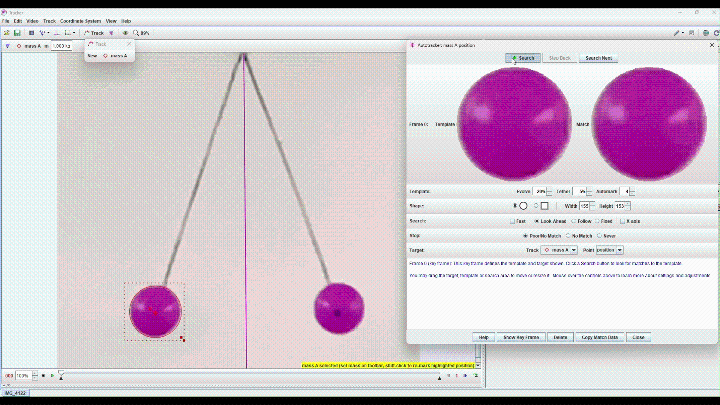
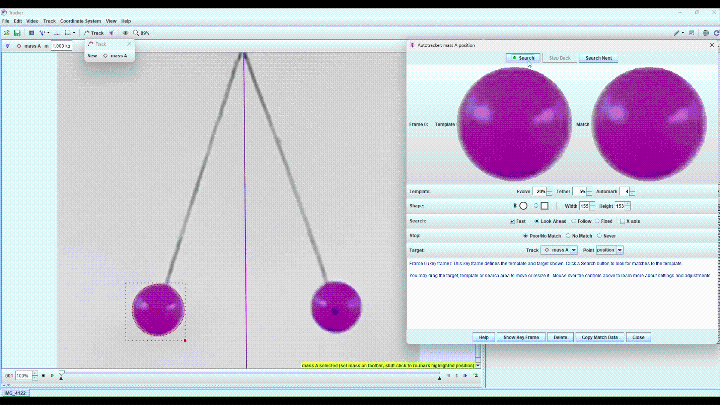
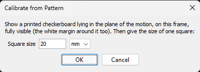
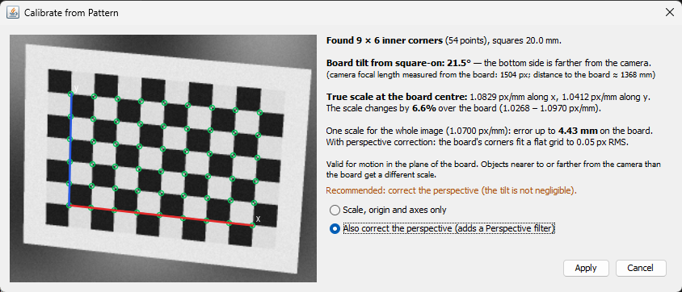

# Tracker-Rust autotracker

An unofficial, modified build of [Tracker](https://physlets.org/tracker/) 6.3.5
(Open Source Physics, by Douglas Brown, Wolfgang Christian and contributors). It is
not affiliated with or endorsed by the Tracker authors.

Tracker 6.3.5 with a much faster AutoTracker: a Rust template
matcher (`tmnative.dll`), read-ahead video decoding, next-frame matching on a
background thread, and fewer UI updates while tracking in Fast mode. Match results
are bit-identical to stock Tracker's integer search (sub-pixel refinement is more
accurate, and can be switched off).

On IMG_4122.mp4 (1080×1920 H.264, template ~155×155 px, search ~180×180 px, Evolve
20%, Look-Ahead, Fast): stock Tracker needs about a second per frame; this build
tracks at **~185 frames per second**.

## Demo

Same video, same template and settings, about 5 seconds of screen recording each:

| Original Tracker 6.3.5 (Fast off) | This build (Fast ticked) |
|---|---|
|  |  |
| frame 2 → 4 | frame 1 → 320 |
| [full-size video](docs/media/track_old.mp4) | [full-size video](docs/media/track_new.mp4) |

## Benchmarks (i5-13450HX, 16 threads)

Charts from `docs/benchmarks` (data: `sweep.csv` from `java/bench/.../SweepBench.java`,
best of two runs; regenerate with `python docs/benchmarks/make_charts.py docs/benchmarks/sweep.csv`;
`index.html` has hover values and the tables):


`java\bench\Bench.java`, synthetic 1280×720, median µs per match:

| template / search | Java (stock) | first Rust | now |
|---|---:|---:|---:|
| 21 / 41 | 879 | 105 | 50 |
| 41 / 101 | 19 155 | 489 | ~330–500 |
| 61 / 201 | 172 644 | 2 316 | ~1 170 |
| 81 / 401 | 1 252 131 | 14 583 | ~2 400–2 600 |

Kernel only (`cargo run --release --example kbench`, set `CARGO_TARGET_DIR` to an
ASCII path; `KB_MODES` / `KB_SCENES` select modes and sizes), 161/185: Java port
1 190 ms, madd all cores ~7 ms, FFT ~2.4 ms, auto ~1.5–2.5 ms.

`java\bench\AccBench.java`, analytically rendered frames with known sub-pixel truth,
RMS error in pixels (parabola → refine):

| case | stock | refine |
|---|---:|---:|
| ball fills template, tpl 15 / 21 / 41 | 0.033 / 0.030 / 0.025 | 0.011 / 0.010 / 0.008 |
| ball + static background ring, tpl 15 / 21 | 0.057 / 0.043 | 0.031 / 0.031 |
| line search (1D), tpl 21, noise σ=3 | 0.230 | 0.022 |

## What is faster, and how



Per tracked frame (1080×1920 video, template ~155 px, search area ~180 px). Original:
everything runs one step after another on Tracker's UI thread. This build: the time the
UI thread spends on the step; the search, the sub-pixel refinement and the decoding run
on background threads, overlapped with the rest of the frame.

| Step | Original Tracker 6.3.5 | | This build | |
|---|---|---:|---|---:|
| Find the match | Java loop over every search position | 896 ms | Rust: AVX2 integer kernel or exact FFT, all cores; next frame matched ahead on a background thread | ~2 ms |
| Sub-pixel position | 3-point parabola | ~0.3 ms | Gauss-Newton on a bicubic-interpolated image (AVX2), about 3× more accurate; ~0.8 ms of compute on the background thread, alongside the search | ~0 |
| Decode the video frame | FFmpeg, 1 thread, on the UI thread | 7.7 ms | 8-thread decoder running up to 8 frames ahead | ~0.04 ms |
| Copy frame for display | per-pixel BGR→RGB copy of the whole frame | 2.0 ms | decoded image used directly | 0 |
| Redraw screen + panels | every frame | 5.9 ms | ~25 times a second | ~1.1 ms |
| Wait for video speed | sleeps to the video's frame rate when faster (Fast off) | up to 42 ms | no wait | 0 |
| **Whole frame** | | **≈ 931 ms (1 fps)** | | **≈ 4.7–5.4 ms (185–213 fps)** |

Sources: matcher and decode timings from the per-frame log
(`%TEMP%\tracker-native-perf.log`, `FastPaint` breakdown) and the `autotest.ps1` runs;
"original" decode/copy/redraw costs are Tracker's own code measured before each change.

## Run

**Install:** download `Tracker-Rust-Setup-<version>.exe` from
[Releases](https://github.com/laplacian-n/tracker-rust-autotracker/releases/latest) and
double-click it. It contains everything (Java runtime and Xuggle from Tracker 6.3.5),
installs for the current user without administrator rights, adds Start menu / desktop
shortcuts and (optionally) opens `.trk`/`.trz` files. The original Tracker is not needed
and, if installed, is not changed. Remove it from Settings → Apps. Silent install:
`Tracker-Rust-Setup-<version>.exe /S [/D=folder] [/desktop]`.

The install folder must have an English-only path (Java cannot start from e.g. a Thai
folder name); with a non-English user name the default is `C:\Users\Public\Tracker-Rust`.
Videos and Tracker files can be anywhere.

From a build (below): with Tracker 6.3.5 in `C:\Program Files\Tracker`, double-click
`tracker-native\Tracker-Rust.bat`.

- File → Open, Save, Import, Export and the other file choosers use the Windows file
  dialog (the File Explorer style picker: quick access, search, previews), with
  Tracker's file types as its "files of type" list. All of Tracker's choosers go through
  `javajs.async.AsyncFileChooser.showDialog`, which hands the request to
  `tmnative.dll` (`IFileOpenDialog`/`IFileSaveDialog`) and puts the result back into the
  chooser; if that is not possible, Tracker's own chooser opens. Independent of Fast.
- The Autotracker's **Fast** checkbox is the switch between this build and stock
  Tracker (`media.core.Patch.ON`):
  - ticked: native matcher + refine, read-ahead decoding, ahead-of-time matching,
    lighter UI updates (and stock Fast: no per-frame sleep or derivatives);
  - unticked (the default): stock Tracker 6.3.5 code paths — Java search loop and
    parabola (`stockMatchLocation`, copied unchanged), stock mask loop, Tracker's own
    decoding, painting, cursor and icon handling, playback-speed throttling.
    `bench\StockCheck.java` checks this mode against the original class from
    `tracker.jar` (identical locations, peaks and match images).
  Saving/restoring Autotracker key frames and the memory settings apply either way.
- Memory: half of physical RAM (1–16 GB) instead of Tracker's 1 GB, and Tracker no longer
  relaunches itself back to 1 GB. Override: `set TRACKER_MEMORY_MB=4096` before starting.
- Works from folders with Thai names (e.g. เอกสาร): the jar is given by a relative path
  and the DLL is loaded from an ASCII copy in `%TEMP%\tracker-native` when needed.
  With the .bat, open files with File → Open (a Thai path passed on the command line
  arrives as "?"); the installed `Tracker-Rust.exe` passes the short (8.3) path instead,
  so double-clicking a .trz in a Thai folder works.
- Per-frame timing goes to `%TEMP%\tracker-native-perf.log` (fps, matcher time, how
  many frames used the ahead-of-time match, and a breakdown every 300 Fast frames).

### Reusing a set-up (axes, calibration, Autotracker template)

Set the axes, tracks and the Autotracker key frame (Ctrl+Shift+click, size the circle
and search area, choose Evolve/Tether/Automark/Fast/...), then **File → Save**. The
.trk/.trz now also stores the Autotracker key frames and settings; opening it goes to
the key frame, rebuilds the template from the video there and opens the Autotracker,
ready to Search. With the same camera position, **Video → Import** (or dropping a new
video on the tab) keeps the axes and rebuilds the template from the new video at the
same place. Stock Tracker ignores the extra `autotracker_keyframes` property.

### Calibrating from a printed checkerboard

Instead of clicking a calibration stick on a zoomed, pixelated frame:

1. Print a board from [`docs/calibration`](docs/calibration) (A4: 15, 20 or 30 mm squares)
   at *Actual size / 100 %* and check the 100 mm line with a ruler.
2. Lay it flat in the plane of the motion and film it for a moment at the start
   (camera not moving afterwards).
3. On a frame where the whole board is visible: **Coordinate System → Calibrate from
   Pattern...**, enter the square size.





<sub>A rendered test frame (board tilted 21.5°), from `java/bench/.../PatternUiShot.java`.</sub>

All inner corners are found to about 0.05 px (`tmnative/src/checker.rs`: saddle points
at several blur scales, grid growing with checker-polarity checks, gradient-based
sub-pixel refinement; works from about 8 px per square). From them
(`media/core/PatternGeometry.java`):

- the plane-to-image homography, the camera focal length and so the **tilt of the
  board from square-on** (and which side is farther), and the camera distance;
- the **true scale at the board centre** along x and y, and how much it changes across
  the board;
- the error left by one scale for the whole image.

Then either scale + origin + axes only (board close to square-on), or **with perspective
correction**: a Perspective filter is added that turns the board's plane square-on,
and the scale is exact everywhere in that plane. On rendered frames with a known
camera (`java/bench/PatternCheck`, `PatternApplyCheck`): tilt and focal length within
0.5 %, centre scale to 4 digits; world positions on the board within 0.04 mm (20 mm
squares) with correction at 3–35° tilt, against 0.3–14 mm with one scale.

Valid for motion in the board's plane only (as with any calibration). The coordinate
change can be undone with Edit → Undo; the filter is removed in Video → Filters.

The Perspective filter's bilinear interpolation is also fixed: stock Tracker 6.3.5 mixes
up the right and lower neighbour pixels (`PerspectiveFilter.getColor`), which shifts
corrected images by up to half a pixel.

## Build

Requirements: Rust (stable, `x86_64-pc-windows-gnu` or `-msvc`), JDK 17+ (looked for in
`JAVA_HOME`/`C:\Program Files\Java\jdk-21`), Tracker 6.3.5 installed (`tracker.jar` is
copied from it into `java\lib`).

```
powershell -ExecutionPolicy Bypass -File build.ps1
```

Refuses to run while Tracker-Rust is open. Builds `tmnative.dll` (cargo, target dir in
`%TEMP%\tmnative-target` because the MinGW linker cannot write Thai paths), compiles
everything in `java\src` against `java\lib\tracker.jar` + Xuggle into `java\patched`,
and makes `tracker-native\tracker-native.jar` = tracker.jar + the patched classes.

Installer:

```
powershell -ExecutionPolicy Bypass -File installer\build-installer.ps1 -Version 1.1.0
```

Copies the OpenJDK runtime and Xuggle from the installed Tracker into `installer\runtime`
(first time only), compiles `Tracker-Rust.exe` (launcher), `Uninstall.exe` and the setup
with the C# compiler that comes with Windows (.NET Framework 4), and embeds everything as
one zip in `installer\build\Tracker-Rust-Setup-<version>.exe`.

## Unattended benchmark

```
powershell -ExecutionPolicy Bypass -File autotest.ps1 [-File pendulum_setup.trz] [-Runs 3] [-NoBuild] [-Env @{TM_NO_ACCEL='1'}]
```

Builds a test jar in `%TEMP%\tracker-autotest` (does not touch `tracker-native\` or a
running Tracker), starts Tracker with main class `AutoTest`, which opens the file
(saved with Autotracker key frames), clears the other steps, runs Search in Fast mode
to the end and exits; prints the step count, total seconds and the fps log.
Environment switches for A/B runs: `TM_NO_ACCEL=1` (refine without Aitken
acceleration), `TM_REFINE_PAR=1` (row-band parallel refine).

## Options (JVM `-D` flags)

| flag | default | meaning |
|---|---|---|
| `tracker.native.mode` | `7` | `-1` = original Java loop, `7` = auto (see `tmnative/src/lib.rs`) |
| `tracker.native.refine` | `true` | `false` = keep Tracker's 3-point parabola (results then bit-identical to stock Tracker) |
| `tracker.native.speculate` | `true` | match the next frame on a background thread |
| `tracker.xuggle.prefetch` | `true` | decode coming frames on a background thread |
| `tracker.fastpaint` | `true` | in Fast mode, repaint ~25×/s and refresh the wizard ~4×/s |
| `tracker.fastpaint.profile` | `true` | per-event timing breakdown in the perf log |
| `tracker.native.perf` | `true` | the perf log itself |
| `tracker.native.dialog` | `true` | open/save with the Windows (File Explorer) dialog; `false` = Tracker's Swing chooser |

## What it does

**Search (integer match)**, exact (same first minimum, same sums as the Java loop):
auto mode picks by estimated time between
- `SSD = |T|² − 2·T·I + |I|²` with AVX2 `vpmaddwd` and row prefix sums, one thread or
  all cores (mode 10/11), and
- FFT correlation (mode 12, rustfft): `r+ig` and `b+i|I|²` packed into two complex
  images, 4 forward + 1 inverse 2D FFT give `2·T·I − Σ|I|²` for every position; it is
  an integer, rounded exactly (error ~1e-5), with a fallback if any value is more than
  1/4 from an integer. Big templates: 161/185 from ~7 ms (madd) to ~2 ms.

**Sub-pixel (refine)**: Gauss-Newton on the masked SSD against a bicubic-interpolated
frame (separable, AVX2+FMA). Line searches (1D axis) stay on the line; stock Tracker
moves along `(cos θ, +sin θ)` there, but the search points run along `(cos θ, −sin θ)`.

**Pipeline** (patched `XuggleVideo`, `TemplateMatcher`, `AutoTracker`, `TrackerPanel`):
- *Read-ahead decoding*: when frames are stepped in order, a second Xuggle decoder with
  FFmpeg frame threads runs up to 8 frames ahead. Frames are identified by
  presentation time stamp, and nothing is used unless its picture for the current
  frame is byte-identical to Tracker's own. Frames come out as INT_RGB and become
  VideoAdapter's buffer directly (no 8 MB copy per frame). Jumps and steps back use
  Tracker's normal path.
- *Speculative matching*: as soon as frame n is matched, frame n+1 is matched on a
  background thread with the predicted search rectangle; the result is used only if
  template, trimmed rectangle and every search-region pixel are identical.
- *Fast mode UI*: repaint requests held to ~25/s, the wizard (dropdowns + pack) refreshed
  ~4/s instead of every frame, no cursor update when the cursor is unchanged, template
  and match icons magnified only when shown, the mask inside-test cached.

Checks: `kbench` compares every mode with the straight Java port; `Bench` signatures;
`PrefetchCheck` (frame CRCs through `VideoAdapter.getImage`, prefetch on vs off, 616
requests incl. jumps and steps back); `SpecCheck` (speculative vs on-the-spot matches
with an evolving template, 299 frames).

## Files

- `tmnative/src/lib.rs` — Rust kernels (madd, FFT, refine) + JNI; `examples/kbench.rs`, `examples/rbench.rs`
- `java/src/org/opensourcephysics/...` — patched Tracker 6.3.5 classes: `media/core/TemplateMatcher`,
  `NativeMatcher`, `media/xuggle/XuggleVideo`, `cabrillo/tracker/AutoTracker`, `TrackerPanel`, `FastPaint`
- `src_orig/` — stock Tracker 6.3.5 sources (from the `version_6.3.5` tag), for reference
- `java/bench` — `Bench`, `AccBench`, `DecodeBench`, `PrefetchCheck`, `SpecCheck`
- `java/src/javajs/async` — `AsyncFileChooser` (patched) and `NativeChooser`: the Windows file dialog;
  `tmnative/src/filedialog.rs` is its native side
- `tmnative/src/checker.rs`, `media/core/PatternGeometry`, `cabrillo/tracker/PatternCalibration` (and the
  menu item in `TMenuBar`) — calibration from a printed checkerboard; `docs/calibration` — printable boards
- `installer/` — launcher, setup and uninstaller (C#), `build-installer.ps1`

## License and credits

Tracker and the Open Source Physics library are © Douglas Brown, Wolfgang Christian and
contributors, licensed under the GNU GPL (version 2 or later). The files under
`java/src` are modified versions of Tracker 6.3.5 sources (changes are marked
`patched:` in the code and listed above); `src_orig` holds the unmodified sources from
the [`version_6.3.5` tag](https://github.com/OpenSourcePhysics/tracker/tree/version_6.3.5)
for comparison. This project as a whole, including the Rust kernel, is distributed under
the **GNU General Public License v3.0 or later** — see [LICENSE](LICENSE).

The repository does not contain Xuggle/FFmpeg or Java. The installer bundles the copies
shipped with Tracker 6.3.5: the OpenJDK 21.0.5 runtime (GPL v2 with Classpath Exception,
notices in `jre\legal`) and Xuggle (GPL/LGPL, source at
[artclarke/xuggle-xuggler](https://github.com/artclarke/xuggle-xuggler)).
